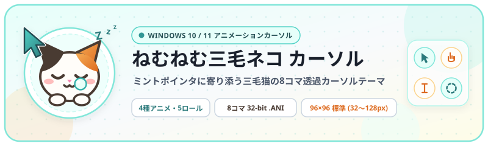
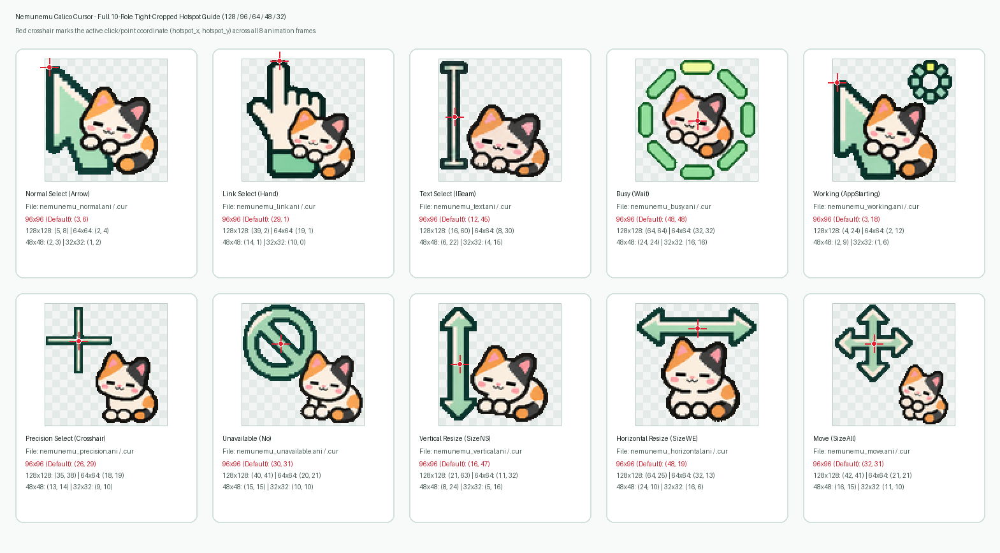

<div align="center">
  

  <h1>🐾 ねむねむ三毛ネコ カーソル (v2)</h1>

  <p><strong>ミントカラーのポインタに寄り添う「ねむねむ三毛ネコ」の Windows 10 / 11 用アニメーションマウスカーソルテーマ</strong></p>

  <p>
    <a href="https://github.com/Sunwood-ai-labs/nemunemu-calico-cursor/actions/workflows/ci.yml"></a>
    <a href="https://sunwood-ai-labs.github.io/nemunemu-calico-cursor/ja/"></a>
    
    
    <a href="./LICENSE"></a>
  </p>

  <p>
    <a href="./README.md">English</a> | <strong>日本語</strong> | <a href="https://sunwood-ai-labs.github.io/nemunemu-calico-cursor/ja/">ドキュメント</a>
  </p>
</div>

---

## ✨ 概要

**ねむねむ三毛ネコ カーソル (Nemunemu Calico Cursor v2)** は、爽やかなミントカラーのポインタの隣で三毛猫がぐーっと伸びをしたり、あくびをしたり、肉球を振ったり、回転リングの中で寝返りを打つ Windows 10 / 11 向けアニメーションマウスカーソルテーマです。すべてのカーソルは **全8フレーム・約160ms周期** の滑らかなループアニメーションで、余白を極限まで詰めたタイトクロップ＆背景完全透過の **32bit BGRA** フォーマット（`.ani` および静止画 `.cur`）として構築されています。

<div align="center">
  
</div>

- **表情豊かな v2 アニメーション（4デザイン・5ロール収録）**: 通常選択 (`Arrow`：伸び＆あくび)、リンク選択 (`Hand`：起きて片手を振る)、テキスト選択 (`IBeam`：Iビームに掴まって縦伸び)、待ち状態 / バックグラウンド作業中 (`Wait` & `AppStarting`：回転リング内で寝返り) をカバー。
- **5段階のマルチサイズ展開 (`128` / `96` デフォルト / `64` / `48` / `32`)**: 全8コマの描画領域に合わせて余白をタイトクロップしているため、三毛猫がキャンバス目いっぱいに大きく表示されます。
- **OSカーソル描画サイズの自動拡大 (`SPI_SETCURSORSIZE`)**: Windows の標準設定 (`CursorBaseSize = 32`) のままだと `.ani` が画面上で 32×32 に縮小描画されてしまいます。`install.ps1` は `CursorBaseSize`・`Accessibility\CursorSize`・Win32 API `SystemParametersInfo(SPI_SETCURSORSIZE)` を自動更新し、デフォルトで **96×96 の大サイズ**（または `-Size 128` で特大サイズ）に即時拡大します。
- **1ピクセル単位で調整されたホットスポット＆安全ロールバック**: 矢印の先端、指先、Iビームの中心軸、スピナーの中央にホットスポットを厳密に配置。`uninstall.ps1` を実行すれば、カーソルだけでなくOSのカーソルサイズ設定（元の `32px`）も `backup-cursors.json` から即座に元通り復元されます。

---

## 🎨 カーソル一覧とホットスポット座標

### アニメーションカーソル プレビュー

| プレビュー | カーソル名 | Windows ロール (`Registry`) | 収録ファイル (`.ani` / `.cur`) | v2 アニメーション説明 |
| :---: | :--- | :--- | :--- | :--- |
|  | **Normal Select (通常選択)** | `Arrow` | `nemunemu_normal.ani`<br>`nemunemu_normal.cur` | ミント色の矢印ポインタの隣で、ぐーっと伸び＆あくびをする三毛猫。 |
|  | **Link Select (リンクの選択)** | `Hand` | `nemunemu_link.ani`<br>`nemunemu_link.cur` | ミント色の袖口の指差しハンドの横で、目を覚まして片手を振る三毛猫。 |
|  | **Text Select (テキスト選択)** | `IBeam` | `nemunemu_text.ani`<br>`nemunemu_text.cur` | ミント色のIビームに掴まって縦に伸びをする三毛猫（クリック軸はIビーム中央に厳密調整）。 |
|  | **Busy / Working (待ち状態・作業中)** | `Wait`<br>`AppStarting` | `nemunemu_busy.ani`<br>`nemunemu_working.ani`<br>`nemunemu_busy.cur`<br>`nemunemu_working.cur` | 8セグメントのミント色カプセルが回る中で、ごろごろ寝返りを打つ三毛猫。 |

### ホットスポット検証ガイドと座標一覧

<div align="center">
  
</div>

| カーソルロール | 原画スプライトシート (4列×2段) | `128×128` | `96×96` (標準) | `64×64` | `48×48` | `32×32` |
| :--- | :--- | :---: | :---: | :---: | :---: | :---: |
| **Normal Select (`Arrow`)** | `assets/sprites/01_normal_sheet.png` | `(5, 8)` | **`(3, 6)`** | `(2, 4)` | `(2, 3)` | `(1, 2)` |
| **Link Select (`Hand`)** | `assets/sprites/02_link_sheet.png` | `(39, 2)` | **`(29, 1)`** | `(19, 1)` | `(14, 1)` | `(10, 0)` |
| **Text Select (`IBeam`)** | `assets/sprites/03_text_sheet.png` | `(16, 60)` | **`(12, 45)`** | `(8, 30)` | `(6, 22)` | `(4, 15)` |
| **Busy / Working (`Wait`, `AppStarting`)** | `assets/sprites/04_busy_sheet.png` | `(64, 64)` | **`(48, 48)`** | `(32, 32)` | `(24, 24)` | `(16, 16)` |

---

## 🚀 クイックスタート（インストール方法）

### 方法1: PowerShell ワンコマンド適用（推奨）

リポジトリのルートディレクトリで以下のコマンドを実行します。カーソル一式を `%LOCALAPPDATA%\Cursors\NemunemuCalico` にコピーし、変更前の設定とカーソルサイズを `backup-cursors.json` に自動バックアップした上で、Win32 API `SystemParametersInfo(SPI_SETCURSORSIZE + SPI_SETCURSORS)` により再起動不要で即座に大きく反映します。

```powershell
# デフォルトの大サイズ (96x96) をインストール（推奨）
powershell -ExecutionPolicy Bypass -File .\install.ps1

# さらに大きい特大サイズ (128x128) をインストールする場合
powershell -ExecutionPolicy Bypass -File .\install.ps1 -Size 128

# 64x64 / 48x48 / 32x32 サイズを指定してインストールする場合
powershell -ExecutionPolicy Bypass -File .\install.ps1 -Size 64
powershell -ExecutionPolicy Bypass -File .\install.ps1 -Size 48
powershell -ExecutionPolicy Bypass -File .\install.ps1 -Size 32
```

### 方法2: `install.inf` を使った GUI 導入

1. エクスプローラーで `install.inf` を右クリックし、**「インストール」** を選択します。
2. Windows の「マウスのプロパティ」（`Win + R` → `main.cpl` → **「ポインター」** タブ）を開きます。
3. デザイン（スキーム）一覧から **Nemunemu Calico** を選択して「適用」をクリックします。

---

## 🔄 アンインストール（元に戻す方法）

自動バックアップ（`%LOCALAPPDATA%\Cursors\NemunemuCalico\backup-cursors.json`）から導入前のカーソル設定および元のカーソルサイズ（`32px`）を復元し、インストール先フォルダをクリーンアップします。

```powershell
powershell -ExecutionPolicy Bypass -File .\uninstall.ps1
```

---

## 🛠️ ソースからのビルドと検証

すべての `.ani` / `.cur` およびプレビュー `.gif` は、`assets/sprites/` 内の `v2` 8コマスプライトシート PNG から `scripts/build_cursors.py` によって自動切り出し・タイトクロップ・生成・検証されます。

```powershell
# 全サイズ (128/96/64/48/32) の .ani / .cur、透過GIF、ホットスポット検証画像を生成
uv run scripts/build_cursors.py

# RIFF ACON 構造、32bit BGRA フレーム、ホットスポット座標、Win32 LoadCursorFromFileW を検証
uv run scripts/build_cursors.py --check
```

---

## 📁 ディレクトリ構成

```text
nemunemu-calico-cursor/
├── assets/
│   ├── gif/                     # タイトクロップ済み透過GIFプレビュー (全8コマ・64x64 および 256x256)
│   ├── sprites/                 # v2 原画スプライトシート (4列×2段 8コマ高解像度PNG)
│   ├── preview/                 # ホットスポット座標検証ガイド (hotspot-guide.png)
│   ├── icon.svg                 # プロジェクトアイコン (128x128)
│   └── header.svg               # リポジトリヘッダーバナー (800x240)
├── cursors/                     # ビルド済み 32bit BGRA .ani / .cur ファイル
│   ├── *.ani / *.cur            # デフォルト大サイズ (96x96)
│   ├── 128x128/                 # 特大 128x128 サイズ
│   ├── 96x96/                   # 大 96x96 サイズ
│   ├── 64x64/                   # 中 64x64 サイズ
│   ├── 48x48/                   # 小 48x48 サイズ
│   └── 32x32/                   # 最小 32x32 サイズ
├── docs/                        # 日英バイリンガル VitePress ドキュメントサイト
├── scripts/
│   └── build_cursors.py         # スプライト切り出し・タイトクロップ・.ani/.cur ビルド＆検証スクリプト
├── install.ps1                  # SPI_SETCURSORSIZE 自動拡大・バックアップ・即時反映インストーラ
├── uninstall.ps1                # バックアップ＆サイズ完全復元アンインストーラ
├── install.inf                  # 右クリック導入用 INF インストーラ
└── LICENSE                      # MIT License
```

---

## 📄 ライセンス

本プロジェクトは [MIT License](./LICENSE) の下で公開されています。Copyright (c) 2026 Sunwood-ai-labs.
