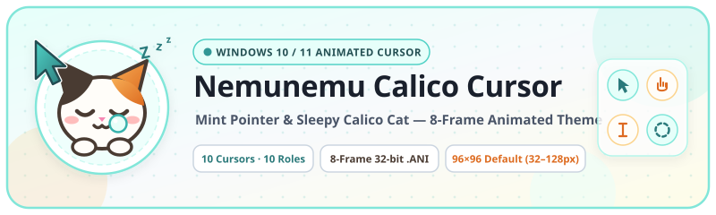
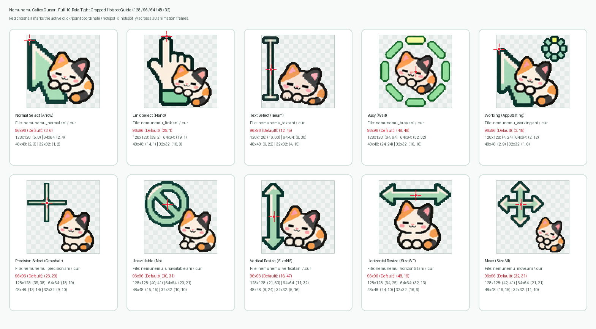

<div align="center">
  

  <h1>🐾 Nemunemu Calico Cursor (v3)</h1>

  <p><strong>A sleepy calico cat &amp; mint pointer animated cursor theme for Windows 10 / 11</strong></p>

  <p>
    <a href="https://github.com/Sunwood-ai-labs/nemunemu-calico-cursor/actions/workflows/ci.yml"></a>
    <a href="https://sunwood-ai-labs.github.io/nemunemu-calico-cursor/"></a>
    
    
    <a href="./LICENSE"></a>
  </p>

  <p>
    <strong>English</strong> | <a href="./README.ja.md">日本語</a> | <a href="https://sunwood-ai-labs.github.io/nemunemu-calico-cursor/">Documentation</a> | <a href="./CHANGELOG.md">Changelog</a> | <a href="https://github.com/Sunwood-ai-labs/nemunemu-calico-cursor/releases">Releases</a>
  </p>
</div>

---

## ✨ Overview

**Nemunemu Calico Cursor** (`ねむねむ三毛ネコ`) is an animated Windows mouse cursor theme featuring a sleepy calico cat stretching, yawning, waving its paw, and rolling beside a crisp mint-colored pointer. Every cursor is crafted as an **8-frame (~160ms per frame)** loop with full alpha transparency (`32-bit BGRA`) and tight bounding-box cropping in both animated (`.ani`) and static (`.cur`) formats.

<div align="center">
  
</div>

- **10 Dedicated v3 Cursor Designs Covering All 10 Everyday Windows Roles**: Out of the 17 standard Windows cursor slots, **v3** provides dedicated custom 8-frame animations for all **10 primary everyday roles** (`Arrow`, `Hand`, `IBeam`, `Wait`, `AppStarting`, `Crosshair`, `No`, `SizeNS`, `SizeWE`, and `SizeAll`). In **v3**, **Busy (`Wait`)** and **Working in Background (`AppStarting`)** are separated into distinct designs (full-ring spinner vs. clickable arrow + spinner), and **Text Select (`IBeam`)** features a refined cat mouth expression.
- **5 Multi-DPI Size Variants (`128` / `96` Default / `64` / `48` / `32`)**: Tightly cropped around the 8-frame union bounding box so the calico cat fills the cursor canvas without wasted margins (120 verified `.ani` & `.cur` files across 6 output directories).
- **Automatic OS Cursor Size Enlargement (`SPI_SETCURSORSIZE`)**: Windows defaults to shrinking custom cursors to `32×32` (`CursorBaseSize = 32`). `install.ps1` automatically updates `CursorBaseSize`, `Accessibility\CursorSize`, and invokes Win32 `SystemParametersInfo(SPI_SETCURSORSIZE)` so your cursor renders at its full large size (`96×96` by default, or `128×128`) immediately.
- **Pixel-Accurate Hotspots & Safe Rollback**: Click hotspots are strictly aligned to each functional pointer tip, crosshair reticle, resize shaft, or spinner center. `uninstall.ps1` restores both your original cursors and your original `32px` OS cursor size from `backup-cursors.json`.

---

## 🎨 Cursor Gallery & Hotspot Coordinates

### Animated Cursor Previews (10 Designs · 10 Roles)

| Preview | Cursor Name | Windows Role (`Registry`) | Animated / Static Files | v3 Animation Description |
| :---: | :--- | :--- | :--- | :--- |
|  | **Normal Select** | `Arrow` | `nemunemu_normal.ani`<br>`nemunemu_normal.cur` | A sleepy calico cat stretching its paws and yawning beside a crisp mint arrow pointer. |
|  | **Link Select** | `Hand` | `nemunemu_link.ani`<br>`nemunemu_link.cur` | A pointing hand with a mint cuff while the calico cat wakes up and waves its paw. |
|  | **Text Select** | `IBeam` | `nemunemu_text.ani`<br>`nemunemu_text.cur` | The calico cat stretching up along a mint I-beam with a refined v3 mouth expression (click axis strictly aligned to the I-beam shaft). |
|  | **Busy** | `Wait` | `nemunemu_busy.ani`<br>`nemunemu_busy.cur` | Dedicated full-wait indicator where the calico cat rolls and stretches inside an 8-segment rotating mint capsule ring. |
|  | **Working in Background** | `AppStarting` | `nemunemu_working.ani`<br>`nemunemu_working.cur` | Separated from `Wait` in v3 — combines an active upper-left mint arrow pointer (tip hotspot) with a mini rotating ring and sleepy calico cat. |
|  | **Precision Select** | `Crosshair` | `nemunemu_precision.ani`<br>`nemunemu_precision.cur` | A crisp mint crosshair reticle with the calico cat peeking beside it (hotspot at the exact reticle intersection). |
|  | **Unavailable** | `No` | `nemunemu_unavailable.ani`<br>`nemunemu_unavailable.cur` | A prohibition circle badge paired with the sleepy calico cat reacting to unavailable actions. |
|  | **Vertical Resize** | `SizeNS` | `nemunemu_vertical.ani`<br>`nemunemu_vertical.cur` | A mint double-headed vertical resize arrow (`↕`) with the calico cat stretching up and down alongside the shaft. |
|  | **Horizontal Resize** | `SizeWE` | `nemunemu_horizontal.ani`<br>`nemunemu_horizontal.cur` | A mint double-headed horizontal resize arrow (`↔`) with the calico cat sprawling and swaying left-to-right. |
|  | **Move** | `SizeAll` | `nemunemu_move.ani`<br>`nemunemu_move.cur` | A four-way mint move cross arrow (`✥`) paired with the calico cat clinging next to the center intersection. |

### Hotspot Verification & Coordinate Table

<div align="center">
  
</div>

| Cursor Role | Sprite Sheet (4×2 Grid) | `128×128` | `96×96` (Default) | `64×64` | `48×48` | `32×32` |
| :--- | :--- | :---: | :---: | :---: | :---: | :---: |
| **Normal Select (`Arrow`)** | `assets/sprites/01_normal_sheet.png` | `(5, 8)` | **`(3, 6)`** | `(2, 4)` | `(2, 3)` | `(1, 2)` |
| **Link Select (`Hand`)** | `assets/sprites/02_link_sheet.png` | `(39, 2)` | **`(29, 1)`** | `(19, 1)` | `(14, 1)` | `(10, 0)` |
| **Text Select (`IBeam`)** | `assets/sprites/03_text_sheet.png` | `(16, 60)` | **`(12, 45)`** | `(8, 30)` | `(6, 22)` | `(4, 15)` |
| **Busy (`Wait`)** | `assets/sprites/04_busy_sheet.png` | `(64, 64)` | **`(48, 48)`** | `(32, 32)` | `(24, 24)` | `(16, 16)` |
| **Working (`AppStarting`)** | `assets/sprites/05_working_sheet.png` | `(4, 24)` | **`(3, 18)`** | `(2, 12)` | `(2, 9)` | `(1, 6)` |
| **Precision Select (`Crosshair`)** | `assets/sprites/06_precision_sheet.png` | `(35, 38)` | **`(26, 29)`** | `(18, 19)` | `(13, 14)` | `(9, 10)` |
| **Unavailable (`No`)** | `assets/sprites/07_unavailable_sheet.png` | `(40, 41)` | **`(30, 31)`** | `(20, 21)` | `(15, 15)` | `(10, 10)` |
| **Vertical Resize (`SizeNS`)** | `assets/sprites/08_vertical_sheet.png` | `(21, 63)` | **`(16, 47)`** | `(11, 32)` | `(8, 24)` | `(5, 16)` |
| **Horizontal Resize (`SizeWE`)** | `assets/sprites/09_horizontal_sheet.png` | `(64, 25)` | **`(48, 19)`** | `(32, 13)` | `(24, 10)` | `(16, 6)` |
| **Move (`SizeAll`)** | `assets/sprites/10_move_sheet.png` | `(42, 41)` | **`(32, 31)`** | `(21, 21)` | `(16, 15)` | `(11, 10)` |

---

## 🚀 Quick Start (Installation)

### Method 1: One-Command PowerShell Install (Recommended)

Run `install.ps1` from PowerShell in the repository root. It copies the cursor files to `%LOCALAPPDATA%\Cursors\NemunemuCalico`, backs up your previous cursor paths and `CursorBaseSize` to `backup-cursors.json`, and immediately activates both the new cursor size (`SPI_SETCURSORSIZE`) and all 10 cursor roles (`SPI_SETCURSORS`) without logging out:

```powershell
# Install default Large 96x96 cursors (recommended for crisp visibility)
powershell -ExecutionPolicy Bypass -File .\install.ps1

# Install Extra-Large 128x128 cursors
powershell -ExecutionPolicy Bypass -File .\install.ps1 -Size 128

# Or install 64x64 / 48x48 / 32x32 variants
powershell -ExecutionPolicy Bypass -File .\install.ps1 -Size 64
powershell -ExecutionPolicy Bypass -File .\install.ps1 -Size 48
powershell -ExecutionPolicy Bypass -File .\install.ps1 -Size 32
```

### Method 2: GUI Install via `install.inf`

1. Right-click `install.inf` in File Explorer and select **Install** (`インストール`).
2. Open the Windows Mouse Properties dialog (`Win + R` → `main.cpl` → **Pointers** tab).
3. Select the **Nemunemu Calico** scheme from the dropdown and click **Apply**.

---

## 🔄 Uninstall & Restore

To restore your previous cursor scheme and original Windows cursor size (`32px`) from `%LOCALAPPDATA%\Cursors\NemunemuCalico\backup-cursors.json`:

```powershell
powershell -ExecutionPolicy Bypass -File .\uninstall.ps1
```

---

## 🛠️ Build & Verify from Source

All 120 `.ani` and `.cur` files (10 roles × 2 formats × 6 target folders) and preview `.gif` files are deterministically generated from the 10 high-resolution 4×2 PNG sprite sheets in `assets/sprites/` using `scripts/build_cursors.py`.

```powershell
# Rebuild all 128/96/64/48/32 .ani/.cur files (120 files), GIF previews, and hotspot-guide.png
uv run scripts/build_cursors.py

# Verify all 120 cursor files (RIFF ACON headers, 32-bit BGRA frames, hotspots, and Win32 LoadCursorFromFileW)
uv run scripts/build_cursors.py --check
```

---

## 📁 Repository Structure

```text
nemunemu-calico-cursor/
├── assets/
│   ├── gif/                     # Tight-cropped 8-frame transparent GIF previews (01..10 64x64 & 256x256 hero)
│   ├── sprites/                 # High-resolution v3 4x2 (8-frame) PNG sprite sheets (01..10)
│   ├── preview/                 # 10-role hotspot coordinate verification guide (hotspot-guide.png)
│   ├── icon.svg                 # Project icon (128x128)
│   ├── header.svg               # English repository hero banner (800x240)
│   └── header.ja.svg            # Japanese repository hero banner (800x240)
├── cursors/                     # Built 32-bit BGRA .ani and .cur files (120 files total across 6 directories)
│   ├── *.ani / *.cur            # Default Large 96x96 cursors (10 roles × 2 formats)
│   ├── 128x128/                 # Extra-Large 128x128 cursors (10 roles × 2 formats)
│   ├── 96x96/                   # Large 96x96 cursors (10 roles × 2 formats)
│   ├── 64x64/                   # Medium 64x64 cursors (10 roles × 2 formats)
│   ├── 48x48/                   # Compact 48x48 cursors (10 roles × 2 formats)
│   └── 32x32/                   # Classic 32x32 cursors (10 roles × 2 formats)
├── docs/                        # Bilingual VitePress documentation site (EN / JA)
├── scripts/
│   └── build_cursors.py         # Sprite sheet slicer, tight-cropper, .ani/.cur builder & 120-file verifier
├── install.ps1                  # One-command installer with SPI_SETCURSORSIZE & live refresh
├── uninstall.ps1                # One-command uninstaller and size/scheme restorer
├── install.inf                  # Windows Explorer right-click INF installer (10 roles)
└── LICENSE                      # MIT License
```

---

## 📄 License

Released under the [MIT License](./LICENSE). Copyright (c) 2026 Sunwood-ai-labs.
