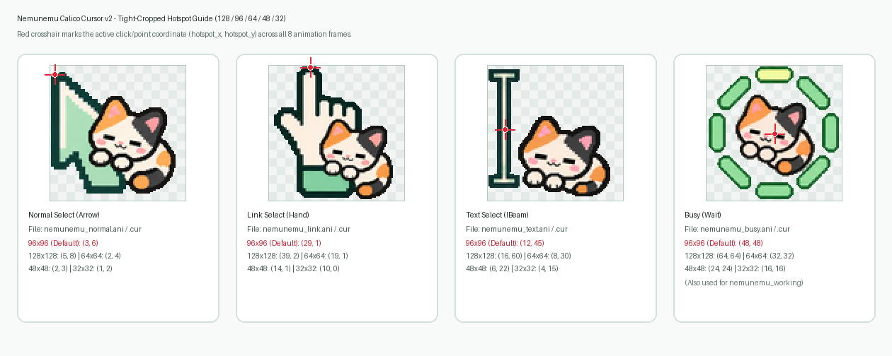

# 🎨 Cursors & Hotspots

Every cursor in **Nemunemu Calico Cursor v2** is an **8-frame (~160ms per frame / 10 jiffies)** animated loop extracted from high-resolution 4×2 sprite sheets, tightly cropped around the 8-frame union bounding box, and encoded as a 32-bit BGRA Windows animated cursor (`.ani`) paired with a static frame-0 cursor (`.cur`).

---

## 🐾 Mascot & Cursor Lineup

### 1. Normal Select (`Arrow`)

- **Files**: `nemunemu_normal.ani` / `nemunemu_normal.cur`
- **Preview GIF**: `assets/gif/01_normal_64.gif`
- **Sprite Sheet**: `assets/sprites/01_normal_sheet.png` (4×2 grid, 8 frames)
- **v2 Animation**: A mint arrow pointer in the upper-left while the sleepy calico cat stretches its paws and yawns beside it.
- **Hotspots**:
  - `128×128`: `(5, 8)`
  - `96×96` (Default): `(3, 6)`
  - `64×64`: `(2, 4)`
  - `48×48`: `(2, 3)`
  - `32×32`: `(1, 2)`

### 2. Link Select (`Hand`)

- **Files**: `nemunemu_link.ani` / `nemunemu_link.cur`
- **Preview GIF**: `assets/gif/02_link_64.gif`
- **Sprite Sheet**: `assets/sprites/02_link_sheet.png` (4×2 grid, 8 frames)
- **v2 Animation**: A pointing index finger with a mint cuff while the calico cat wakes up and waves its paw.
- **Hotspots**:
  - `128×128`: `(39, 2)`
  - `96×96` (Default): `(29, 1)`
  - `64×64`: `(19, 1)`
  - `48×48`: `(14, 1)`
  - `32×32`: `(10, 0)`

### 3. Text Select (`IBeam`)

- **Files**: `nemunemu_text.ani` / `nemunemu_text.cur`
- **Preview GIF**: `assets/gif/03_text_64.gif`
- **Sprite Sheet**: `assets/sprites/03_text_sheet.png` (4×2 grid, 8 frames)
- **v2 Animation**: A mint I-beam text cursor on the left while the calico cat stretches vertically along the shaft. The click axis is strictly aligned to the vertical center of the I-beam bar for accurate text selection.
- **Hotspots**:
  - `128×128`: `(16, 60)`
  - `96×96` (Default): `(12, 45)`
  - `64×64`: `(8, 30)`
  - `48×48`: `(6, 22)`
  - `32×32`: `(4, 15)`

### 4. Busy / Working (`Wait` & `AppStarting`)

- **Files**: `nemunemu_busy.ani`, `nemunemu_working.ani`, `nemunemu_busy.cur`, `nemunemu_working.cur`
- **Preview GIF**: `assets/gif/04_busy_64.gif`
- **Sprite Sheet**: `assets/sprites/04_busy_sheet.png` (4×2 grid, 8 frames)
- **v2 Animation**: The calico cat rolling and stretching inside an 8-segment rotating mint capsule ring. Assigned to both `Wait` (Busy) and `AppStarting` (Working in Background).
- **Hotspots**:
  - `128×128`: `(64, 64)`
  - `96×96` (Default): `(48, 48)`
  - `64×64`: `(32, 32)`
  - `48×48`: `(24, 24)`
  - `32×32`: `(16, 16)`

---

## 🎯 Hotspot Coordinate Verification

The hotspot guide image (`assets/preview/hotspot-guide.png`) overlays red crosshairs at the exact `(X, Y)` click coordinates for every cursor role:

| Role | Windows Registry Key | `128×128` | `96×96` (Default) | `64×64` | `48×48` | `32×32` |
| :--- | :--- | :---: | :---: | :---: | :---: | :---: |
| **Normal Select** | `Arrow` | `(5, 8)` | **`(3, 6)`** | `(2, 4)` | `(2, 3)` | `(1, 2)` |
| **Link Select** | `Hand` | `(39, 2)` | **`(29, 1)`** | `(19, 1)` | `(14, 1)` | `(10, 0)` |
| **Text Select** | `IBeam` | `(16, 60)` | **`(12, 45)`** | `(8, 30)` | `(6, 22)` | `(4, 15)` |
| **Busy / Working** | `Wait`, `AppStarting` | `(64, 64)` | **`(48, 48)`** | `(32, 32)` | `(24, 24)` | `(16, 16)` |
