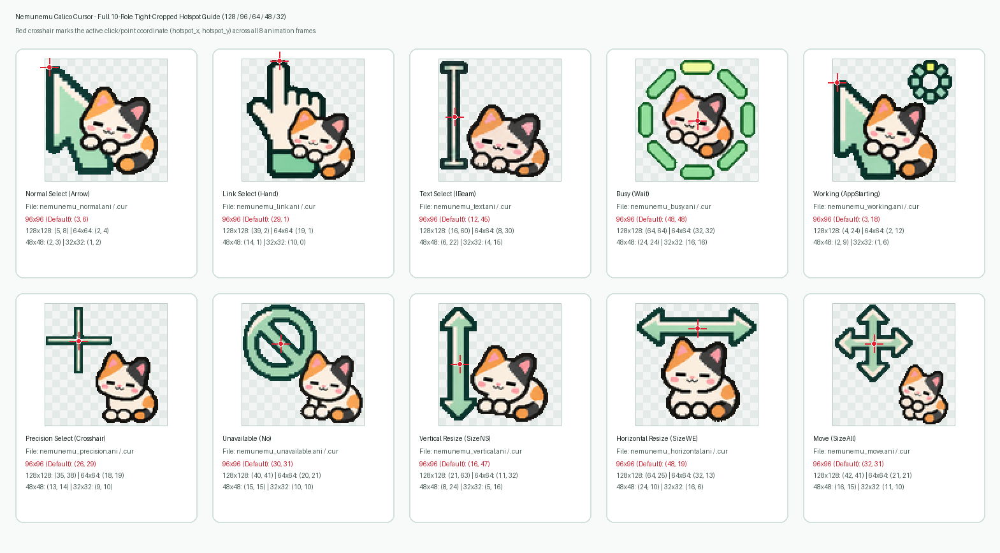

# 🎨 カーソル一覧とホットスポット

**ねむねむ三毛ネコ カーソル (Nemunemu Calico Cursor)** のすべてのカーソルは、**全8フレーム（約160ms / 10 jiffies 周期）** の 32bit BGRA Windows アニメーションカーソル（`.ani`）と、第0フレームを切り出した静止画カーソル（`.cur`）のペアで構成されています。

---

## 🐾 マスコットと収録カーソル詳細

### 1. Normal Select (`Arrow`) — 通常選択

- **ファイル名**: `nemunemu_normal.ani` / `nemunemu_normal.cur`
- **元GIF**: `assets/gif/01_normal_64.gif`
- **原画スプライトシート**: `assets/sprites/01_normal_sheet.png` (4列×2段 8コマPNG)
- **デザイン**: 左上のミント色の矢印ポインタの隣で、うとうと居眠りする三毛猫。
- **ホットスポット座標**:
  - `64×64`: `(11, 9)`
  - `48×48`: `(8, 7)`
  - `32×32`: `(6, 5)`

### 2. Link Select (`Hand`) — リンクの選択

- **ファイル名**: `nemunemu_link.ani` / `nemunemu_link.cur`
- **元GIF**: `assets/gif/02_link_64.gif`
- **原画スプライトシート**: `assets/sprites/02_link_sheet.png` (4列×2段 8コマPNG)
- **デザイン**: ミント色の袖口の指差しハンドと、その横に寄り添う三毛猫。
- **ホットスポット座標**:
  - `64×64`: `(21, 6)`
  - `48×48`: `(16, 5)`
  - `32×32`: `(11, 3)`

### 3. Text Select (`IBeam`) — テキスト選択

- **ファイル名**: `nemunemu_text.ani` / `nemunemu_text.cur`
- **元GIF**: `assets/gif/03_text_64.gif`
- **原画スプライトシート**: `assets/sprites/03_text_sheet.png` (4列×2段 8コマPNG)
- **デザイン**: ミント色のIビームの横に座る三毛猫。文字選択の操作性を損なわないよう、クリック軸（ホットスポット）はIビームの中央に厳密に調整されています。
- **ホットスポット座標**:
  - `64×64`: `(18, 32)`
  - `48×48`: `(14, 24)`
  - `32×32`: `(9, 16)`

### 4. Busy / Working (`Wait` & `AppStarting`) — 待ち状態・バックグラウンド作業中

- **ファイル名**: `nemunemu_busy.ani`, `nemunemu_working.ani`, `nemunemu_busy.cur`, `nemunemu_working.cur`
- **元GIF**: `assets/gif/04_busy_64.gif`
- **原画スプライトシート**: `assets/sprites/04_busy_sheet.png` (4列×2段 8コマPNG)
- **デザイン**: 丸くなって眠る三毛猫の周りを、8個のミント色カプセルが順番に回るローディングインジケータ。`Wait`（待ち状態）と `AppStarting`（バックグラウンド作業中）の両ロールに割り当てられます。
- **ホットスポット座標**:
  - `64×64`: `(32, 32)`
  - `48×48`: `(24, 24)`
  - `32×32`: `(16, 16)`

---

## 🎯 ホットスポット座標の検証

ホットスポット検証ガイド画像（`assets/preview/hotspot-guide.png`）では、各カーソルのクリック判定位置 `(X, Y)` に赤い十字ターゲットを重ねて視覚的に検証しています。

| ロール名 | Windows レジストリキー | `64×64` ホットスポット | `48×48` ホットスポット | `32×32` ホットスポット |
| :--- | :--- | :---: | :---: | :---: |
| **Normal Select (通常選択)** | `Arrow` | `(11, 9)` | `(8, 7)` | `(6, 5)` |
| **Link Select (リンクの選択)** | `Hand` | `(21, 6)` | `(16, 5)` | `(11, 3)` |
| **Text Select (テキスト選択)** | `IBeam` | `(18, 32)` | `(14, 24)` | `(9, 16)` |
| **Busy / Working (待ち・作業中)** | `Wait`, `AppStarting` | `(32, 32)` | `(24, 24)` | `(16, 16)` |
